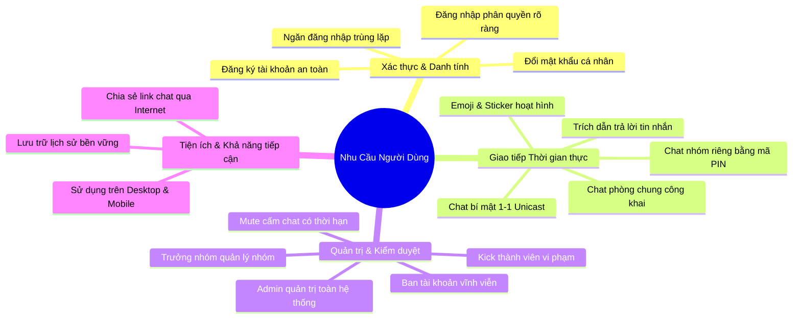
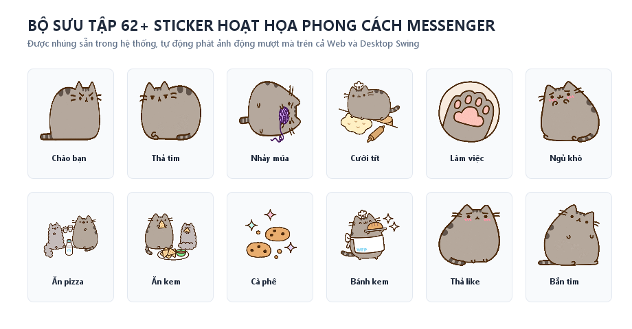
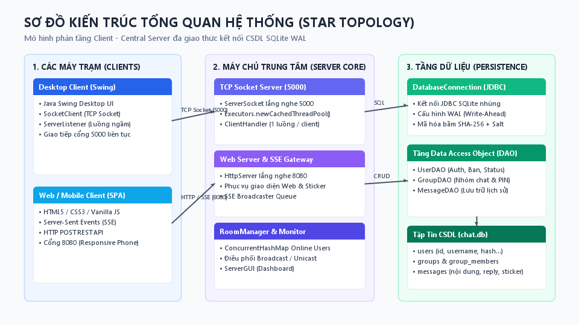
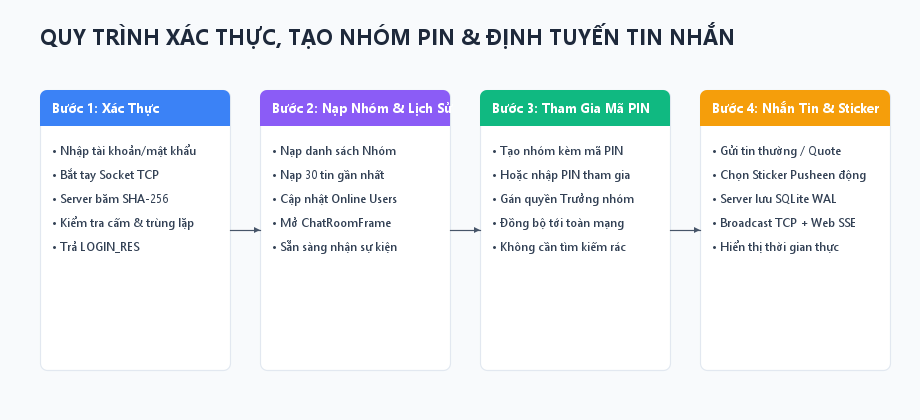
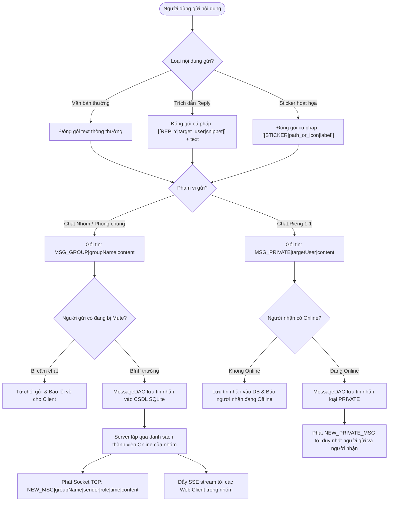
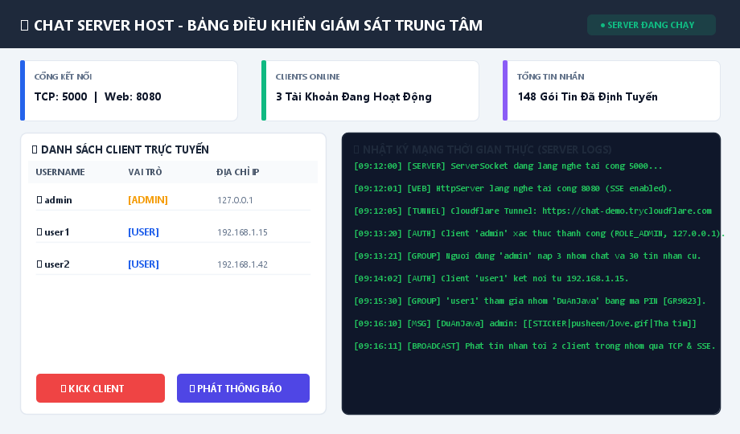
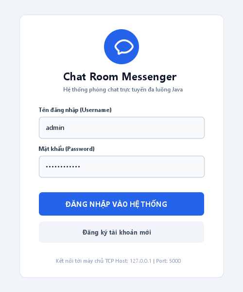
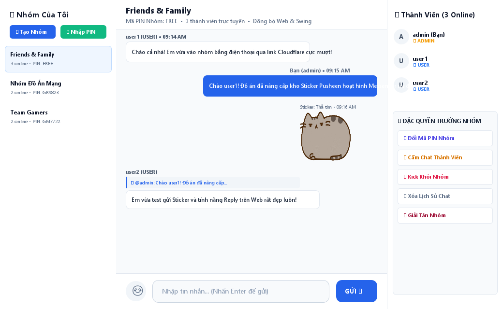
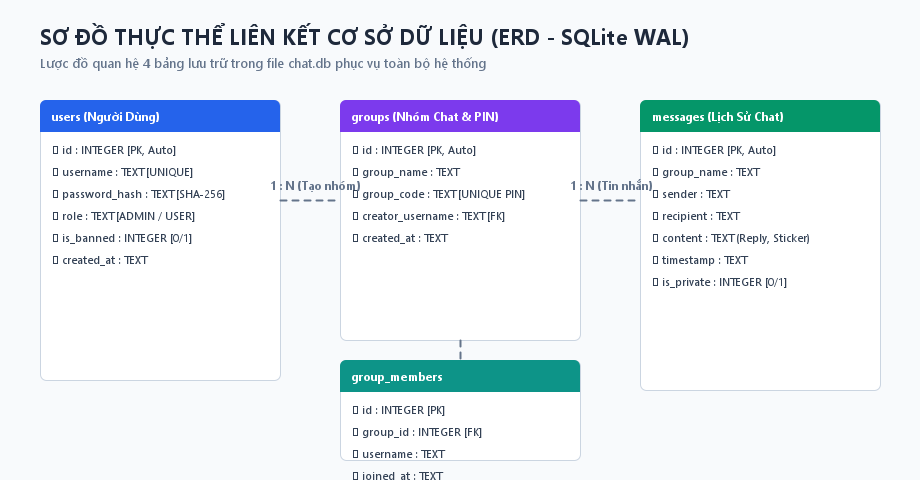
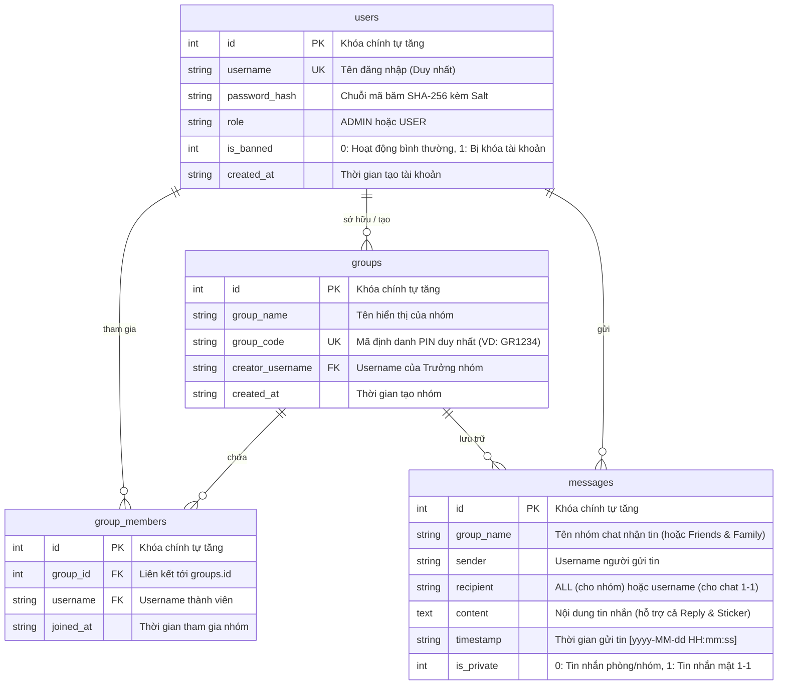

# BÁO CÁO ĐỒ ÁN MÔN HỌC: LẬP TRÌNH MẠNG
## ĐỀ TÀI: XÂY DỰNG HỆ THỐNG PHÒNG CHAT TRỰC TUYẾN ĐA NGƯỜI DÙNG (REAL-TIME MULTI-CLIENT CHAT SERVER)
**Công nghệ & Kỹ thuật:** Java Socket TCP Đa luồng, Thread Pool (`ExecutorService`), HTTP + Server-Sent Events (SSE), SQLite WAL JDBC, SHA-256 + Salt, Java Swing Desktop GUI, Web Responsive SPA, Cloudflare Tunnel.

---

## MỤC LỤC
1. [PHẦN 1: GIỚI THIỆU TỔNG QUAN](#phần-1-giới-thiệu-tổng-quan)
   - 1.1. Bối cảnh và Lý do chọn đề tài
   - 1.2. Mục tiêu nghiên cứu và xây dựng hệ thống
   - 1.3. Đối tượng sử dụng và Phạm vi đồ án
   - 1.4. Ý nghĩa khoa học và thực tiễn
2. [PHẦN 2: PHÂN TÍCH HỆ THỐNG](#phần-2-phân-tích-hệ-thống)
   - 2.1. Phân tích nhu cầu người dùng (User Requirements)
   - 2.2. Phân tích bài toán kỹ thuật cốt lõi
   - 2.3. Khảo sát & Đánh giá ưu - nhược điểm của các hệ thống tương tự
   - 2.4. Đề xuất các tính năng mới và điểm sáng tạo của đồ án
3. [PHẦN 3: THIẾT KẾ HỆ THỐNG & ỨNG DỤNG](#phần-3-thiết-kế-hệ-thống--ứng-dụng)
   - 3.1. Sơ đồ kiến trúc tổng quan hệ thống (System Architecture)
   - 3.2. Sơ đồ hoạt động các quy trình nghiệp vụ chính (Activity Diagrams)
   - 3.3. Thiết kế chi tiết các chức năng phía Máy chủ (Server-Side Specifications)
   - 3.4. Thiết kế chi tiết các chức năng phía Máy trạm (Client-Side Specifications)
   - 3.5. Thiết kế tổ chức dữ liệu & Giao thức truyền tin (Data & Protocol Design)
4. [PHẦN 4: CƠ CHẾ ĐA LUỒNG & BẢO MẬT CHUYÊN SÂU](#phần-4-cơ-chế-đa-luồng--bảo-mật-chuyên-sâu)
   - 4.1. Điều phối đa luồng phía Server & Tránh lãng phí tài nguyên
   - 4.2. Xử lý an toàn luồng phía Client & Chống đứng giao diện (UI Freeze)
   - 4.3. Cơ chế đồng bộ hóa dữ liệu SQLite WAL đa luồng
   - 4.4. Mô hình bảo mật xác thực danh tính SHA-256 with Salt
5. [PHẦN 5: BẢNG PHÂN CHIA VAI TRÒ & TRÁCH NHIỆM 4 THÀNH VIÊN](#phần-5-bảng-phân-chia-vai-trò--trách-nhiệm-4-thành-viên)
6. [PHẦN 6: BỘ CÂU HỎI VẤN ĐÁP & HƯỚNG DẪN TRẢ LỜI ĐẠT ĐIỂM TỐI ĐA](#phần-6-bộ-câu-hỏi-vấn-đáp--hướng-dẫn-trả-lời-đạt-điểm-tối-đa)

---

# PHẦN 1: GIỚI THIỆU TỔNG QUAN

## 1.1. Bối cảnh và Lý do chọn đề tài
Trong kỷ nguyên số hóa và làm việc từ xa, nhu cầu trao đổi thông tin liên lạc tức thời (Real-time Instant Messaging) đóng vai trò huyết mạch trong mọi tổ chức, trường học và doanh nghiệp. Hàng loạt nền tảng trò chuyện nổi tiếng như Facebook Messenger, Discord, Telegram hay Slack đã chứng minh sức mạnh của mô hình giao tiếp phân tán thời gian thực.

Tuy nhiên, đối với sinh viên chuyên ngành Công nghệ thông tin và Kỹ thuật mạng, việc chỉ sử dụng các Framework bậc cao (High-level Frameworks) như Firebase, Socket.IO hoặc SignalR thường làm lu mờ đi bản chất hoạt động cốt lõi của tầng mạng (Transport Layer). Các câu hỏi nền tảng như:
- *Làm thế nào một byte dữ liệu được truyền qua luồng Socket TCP?*
- *Hệ thống điều phối hàng chục kết nối đồng thời ra sao mà không gây tắc nghẽn CPU?*
- *Giao thức tầng ứng dụng được tự thiết kế và phân tích cú pháp (parsing) như thế nào?*
- *Làm sao đồng bộ dữ liệu thời gian thực giữa một ứng dụng Desktop Socket truyền thống với một ứng dụng Web hiện đại?*

Chính vì những lý do trên, nhóm đã quyết định lựa chọn đề tài **"Xây dựng hệ thống phòng chat trực tuyến đa người dùng (Real-time Multi-client Chat Server)"**. Đề tài được xây dựng từ nền tảng Socket cốt lõi bằng ngôn ngữ **Java**, kết hợp hài hòa giữa kiến trúc Client-Server truyền thống và các công nghệ giao tiếp hiện đại.

## 1.2. Mục tiêu nghiên cứu và xây dựng hệ thống
Đồ án đặt ra 2 nhóm mục tiêu trọng tâm:

### A. Mục tiêu học thuật & Kỹ thuật mạng
1. **Nắm vững kỹ thuật lập trình Socket TCP:** Hiện thực hóa cơ chế kết nối tin cậy thông qua `ServerSocket` và `Socket`, quản lý luồng dữ liệu hai chiều (`InputStream`, `OutputStream`).
2. **Làm chủ kỹ thuật Đa luồng (Multi-threading) & Đồng thời (Concurrency):** Ứng dụng giải pháp Thread Pool (`ExecutorService`) để tối ưu việc tái sử dụng luồng, kết hợp các cấu trúc dữ liệu an toàn luồng (`ConcurrentHashMap`) nhằm loại trừ hoàn toàn nguy cơ tranh chấp dữ liệu (Race Condition) và khóa chết (Deadlock).
3. **Tự thiết kế Giao thức tầng ứng dụng (Application Layer Protocol):** Xây dựng bộ giao thức truyền tin chuẩn chuỗi ký tự UTF-8 phân tách trường, có khả năng mở rộng linh hoạt cho nhiều loại bản tin khác nhau.
4. **Quản trị dữ liệu quan hệ bền vững:** Tích hợp hệ quản trị CSDL nhúng **SQLite** với chế độ ghi nhật ký trước **WAL (Write-Ahead Logging)**, cho phép đọc/ghi đồng thời tốc độ cao.
5. **Đảm bảo an toàn thông tin:** Ứng dụng giải pháp mã hóa băm mật khẩu chuẩn công nghiệp **SHA-256 kết hợp chuỗi Salt ngẫu nhiên**, chống lại các cuộc tấn công tra từ điển và bảng băm sẵn (Rainbow Table).

### B. Mục tiêu sản phẩm & Ứng dụng thực tiễn
1. **Hỗ trợ Đa nền tảng (Cross-platform):** Đồng thời phục vụ cả ứng dụng máy tính **Desktop Java Swing** và ứng dụng **Web Responsive** trên trình duyệt/điện thoại di động.
2. **Cơ chế Nhóm chat linh hoạt & Mã định danh (PIN) độc nhất:** Người dùng có thể tự tạo phòng chat riêng và mời bạn bè tham gia nhanh chóng thông qua mã PIN bảo mật không trùng lặp.
3. **Phân quyền người dùng chặt chẽ:** Tách bạch rõ ràng quyền hạn giữa Quản trị viên hệ thống (Admin), Trưởng nhóm chat (Group Leader) và Thành viên thông thường (User).
4. **Trải nghiệm giao tiếp hiện đại:** Hỗ trợ tính năng Trích dẫn trả lời (Reply/Quote), bộ biểu tượng Emoji và kho **Sticker hoạt họa động (Animated GIF)** phong cách Facebook Messenger.
5. **Khả năng chia sẻ Internet 1-Click:** Tích hợp Cloudflare Tunnel tự động mở cổng bảo mật HTTPS ra Internet mà không cần can thiệp mở cổng modem (Port Forwarding).

## 1.3. Đối tượng sử dụng và Phạm vi đồ án
- **Đối tượng hướng tới:** Các nhóm học tập, lớp học, câu lạc bộ hoặc các phòng ban nội bộ cần một hệ thống trao đổi thông tin thời gian thực gọn nhẹ, hoàn toàn tự chủ dữ liệu (Self-hosted), không bị phụ thuộc vào dịch vụ đám mây của bên thứ ba.
- **Phạm vi hệ thống:**
  - Triển khai theo mô hình tập trung hình sao (Star Topology) với một Server trung tâm lắng nghe cổng TCP `5000` (dành cho Desktop Client) và cổng Web HTTP/SSE `8080` (dành cho Web/Mobile Client).
  - Hoạt động ổn định trên cả mạng cục bộ nội bộ (LAN / Wi-Fi) và mạng diện rộng công cộng (Internet qua Cloudflare Tunnel).

## 1.4. Ý nghĩa khoa học và thực tiễn
- **Về mặt khoa học:** Giúp sinh viên nắm vững nguyên lý hoạt động của các tầng giao thức trong mô hình OSI/TCP-IP, hiểu rõ sự khác biệt giữa giao tiếp liên tục hướng kết nối (Socket TCP Streams) và giao tiếp bán song công hướng sự kiện (HTTP REST + Server-Sent Events).
- **Về mặt thực tiễn:** Tạo ra một sản phẩm phần mềm hoàn chỉnh, có tính ứng dụng thực tế cao, giao diện thẩm mỹ hiện đại, dễ dàng đóng gói thành các file `.jar` và bộ cài đặt chạy ngay trên mọi máy tính có cài đặt máy ảo Java (JVM).

---

# PHẦN 2: PHÂN TÍCH HỆ THỐNG

## 2.1. Phân tích nhu cầu người dùng (User Requirements Analysis)

Qua khảo sát thực tế hành vi của người dùng trong các ứng dụng chat hiện đại, hệ thống cần đáp ứng đầy đủ các nhóm nhu cầu sau:



1. **Nhóm nhu cầu Xác thực & Bảo mật danh tính:**
   - Người dùng cần có tài khoản cá nhân để định danh trong phòng chat.
   - Mật khẩu phải được bảo vệ tuyệt đối, không được lưu dạng văn bản thô.
   - Hệ thống phải ngăn chặn hiện tượng 1 tài khoản đăng nhập đồng thời ở 2 nơi để tránh xung đột dữ liệu.
2. **Nhóm nhu cầu Giao tiếp & Tương tác:**
   - Nhắn tin tức thời với độ trễ tính bằng mili-giây.
   - Phân loại rõ ràng: Tin nhắn phòng chung (Broadcast), Tin nhắn nhóm riêng tư và Tin nhắn riêng mật 1-1 (Unicast).
   - Khả năng trích dẫn ngữ cảnh (Quote/Reply) giúp các cuộc thảo luận mạch lạc, không bị trôi tin.
   - Nhu cầu biểu đạt cảm xúc sinh động qua Emoji và Sticker hoạt họa phong cách Facebook Messenger.
3. **Nhóm nhu cầu Quản trị & Điều phối:**
   - Người tạo nhóm phải có toàn quyền kiểm soát nhóm của mình (đổi mã PIN, mời/kick thành viên, cấm chat thành viên trong nhóm, xóa lịch sử, giải tán nhóm).
   - Quản trị viên hệ thống (Admin) cần công cụ giám sát trực tiếp số lượng người online, lưu lượng tin nhắn, và có quyền xử lý các hành vi vi phạm chuẩn mực (Mute tạm thời, Kick ra khỏi server, Ban vĩnh viễn).
4. **Nhóm nhu cầu Tiện ích & Truy cập đa nền tảng:**
   - Không bị mất tin nhắn khi tắt máy (lịch sử trò chuyện phải được lưu trữ bền vững).
   - Dễ dàng kết nối trên cả máy tính (giao diện Swing chuyên nghiệp) lẫn điện thoại (giao diện Web mượt mà không cần cài đặt phần mềm).

## 2.2. Phân tích bài toán kỹ thuật cốt lõi

Để hiện thực hóa các nhu cầu trên, hệ thống phải giải quyết 5 bài toán kỹ thuật phức tạp:

### Bài toán 1: Xử lý đồng thời cao (High Concurrency & Multi-threading)
- **Thách thức:** Mỗi kết nối Socket TCP chiếm giữ một kênh truyền dữ liệu liên tục. Nếu mỗi Client tạo một `new Thread()` riêng lẻ thì khi có 100 hay 1.000 Client kết nối, bộ nhớ Stack của JVM sẽ nhanh chóng cạn kiệt, dẫn đến lỗi kinh điển `java.lang.OutOfMemoryError: unable to create new native thread`, đồng thời CPU quá tải do chi phí chuyển đổi ngữ cảnh (Context Switching).
- **Giải pháp kỹ thuật:** Ứng dụng mô hình **Thread Pool** thông qua `Executors.newCachedThreadPool()`. Server duy trì một hồ bơi luồng có khả năng tự động co giãn, tái sử dụng các luồng nhàn rỗi và tự động hủy các luồng không sử dụng sau 60 giây, giúp tối ưu hóa tuyệt đối việc sử dụng RAM và CPU.

### Bài toán 2: Đồng bộ dữ liệu hai chiều giữa hai giao thức khác biệt (TCP Socket vs HTTP/SSE)
- **Thách thức:** 
  - Desktop Swing Client giao tiếp qua **TCP Socket thuần liên tục** (Stream-based), giữ kết nối mở lâu dài.
  - Web Browser Client giao tiếp qua **giao thức HTTP không trạng thái (Stateless)**, không thể nhận trực tiếp byte TCP socket thô nếu không dùng WebSocket phức tạp.
- **Giải pháp kỹ thuật:** Xây dựng lõi **Dual-Protocol Gateway** trong `ChatServer`. Máy chủ tích hợp sẵn module `WebChatServer` chạy cơ chế **Server-Sent Events (SSE)** tại endpoint `/api/stream`. Khi có tin nhắn từ Socket TCP, Server tự động đẩy qua hàng đợi SSE để bắn về Web Client; ngược lại, khi Web Client gửi tin qua HTTP POST `/api/send`, Server chuyển đổi gói tin sang giao thức Socket TCP để phát tới các Client Desktop. Cả hai thế giới được đồng bộ 100% thời gian thực.

### Bài toán 3: Tranh chấp tài nguyên CSDL nhúng (Database Concurrency & Locking)
- **Thách thức:** SQLite là CSDL nhúng (File-based DB). Ở chế độ mặc định (`journal_mode = DELETE`), mỗi khi có một thao tác Ghi (`INSERT/UPDATE`), toàn bộ file CSDL bị khóa độc quyền (Exclusive Lock), khiến các luồng Đọc (`SELECT`) bị nghẽn (Database Busy / Locked Exception).
- **Giải pháp kỹ thuật:** Cấu hình SQLite hoạt động ở chế độ **Write-Ahead Logging (WAL)**:
  ```sql
  PRAGMA journal_mode=WAL;
  PRAGMA busy_timeout=5000;
  PRAGMA synchronous=NORMAL;
  ```
  Chế độ WAL ghi các thay đổi vào file log riêng biệt (`chat.db-wal`), cho phép **vô số luồng Đọc chạy song song cùng lúc với 1 luồng Ghi**, tăng hiệu năng truy xuất I/O lên gấp 5-10 lần.

### Bài toán 4: Chống đứng giao diện người dùng (UI Freezing)
- **Thách thức:** Trong Java Swing, nếu gọi lệnh đọc socket `in.readLine()` trực tiếp trên luồng giao diện chính (Event Dispatch Thread - EDT), toàn bộ cửa sổ sẽ bị treo cứng (Not Responding) trong lúc chờ dữ liệu từ mạng.
- **Giải pháp kỹ thuật:** Áp dụng mô hình **Bất đồng bộ đa luồng**: Luồng giao diện EDT chỉ làm nhiệm vụ vẽ giao diện và bắt sự kiện bàn phím/chuột. Một luồng nền độc lập (`ServerListener`) liên tục chờ đọc dữ liệu từ Socket. Khi nhận được tin nhắn mới, `ServerListener` sử dụng phương thức an toàn `SwingUtilities.invokeLater(...)` để bàn giao tác vụ cập nhật giao diện về cho EDT, tuân thủ nguyên tắc Single-Thread Rule của Swing.

### Bài toán 5: Bảo vệ mật khẩu người dùng
- **Thách thức:** Lưu mật khẩu dạng thô (Plain-text) là lỗi bảo mật nghiêm trọng nhất. Kể cả khi băm bằng MD5 hay SHA-1 đơn thuần, kẻ tấn công vẫn dễ dàng tra cứu ngược qua các bảng băm sẵn (Rainbow Table).
- **Giải pháp kỹ thuật:** Áp dụng giải pháp **SHA-256 kết hợp chuỗi Muối hệ thống bí mật (Salt)**:
  $$\text{Hash} = \text{SHA-256}(\text{RawPassword} + \text{SystemSalt})$$
  Đảm bảo chuỗi băm sinh ra luôn duy nhất, triệt tiêu hoàn toàn khả năng dò quét mật khẩu phổ biến.

## 2.3. Khảo sát & Đánh giá ưu - nhược điểm của các hệ thống tương tự

Để định vị rõ ưu thế công nghệ của đồ án, nhóm đã tiến hành khảo sát so sánh 4 hệ thống trò chuyện phổ biến:

| Tiêu chí so sánh | IRC (Internet Relay Chat) | Facebook Messenger / Zalo | Hệ thống Node.js Socket.IO | **Hệ Thống Đồ Án Của Nhóm** |
| :--- | :--- | :--- | :--- | :--- |
| **Giao thức cốt lõi** | TCP Socket thuần dạng text | HTTP/2, WebSocket, MQTT | WebSocket / Polling | **TCP Socket Đa luồng + HTTP/SSE** |
| **Kiến trúc dữ liệu** | Không lưu trữ lịch sử trên server | CSDL phân tán khổng lồ (Cassandra/MySQL) | MongoDB / Redis / PostgreSQL | **SQLite WAL File-based nhúng tự chứa** |
| **Đa nền tảng** | Chủ yếu CLI / Desktop cổ điển | Mobile App, Web Browser | Web, Desktop Electron | **Desktop Swing Neumorphism + Web Mobile SPA** |
| **Mức độ phụ thuộc** | Thấp, cần cài IRC Client | Hoàn toàn phụ thuộc Cloud Meta/VNG | Cần cài Node runtime và npm modules | **Độc lập 100%, chạy ngay trên JVM, không phụ thuộc** |
| **Quản trị phòng chat** | Phân quyền Channel Op (`@`, `+`) | Nhóm chat, Trưởng nhóm | Tự lập trình tùy biến | **Hệ thống 2 tầng: Admin hệ thống + Trưởng nhóm PIN** |
| **Trải nghiệm tương tác** | Chỉ hỗ trợ văn bản đơn thuần | Sticker, Emoji, Reply, Voice | Tùy biến theo code UI | **Hỗ trợ Reply, Emoji và 62+ Sticker GIF Messenger** |
| **Triển khai ra Internet** | Cần IP tĩnh hoặc mở Port modem | Hạ tầng toàn cầu có sẵn | Cần thuê VPS / Cloud | **1-Click Cloudflare Tunnel tự động sinh link HTTPS** |

### Đánh giá rút ra:
- **IRC:** Rất nhẹ và thuần socket nhưng quá nghèo nàn về trải nghiệm người dùng, không có lịch sử trò chuyện bền vững và không thân thiện với người dùng phổ thông.
- **Messenger / Discord:** Trải nghiệm hoàn hảo nhưng là hệ thống nguồn đóng, phụ thuộc hoàn toàn vào máy chủ nước ngoài, dữ liệu người dùng bị giám sát và không thể tự triển khai nội bộ.
- **Hệ thống của nhóm:** Kế thừa trọn vẹn sự tinh gọn, tin cậy của TCP Socket từ IRC, đồng thời mang lại trải nghiệm giao diện hiện đại (Bong bóng chat, Sticker hoạt họa, Reply) giống Messenger, kết hợp cơ chế CSDL nhúng SQLite giúp đồ án có thể mang đi nộp, chạy demo trên bất kỳ máy tính nào mà không cần cài đặt môi trường phức tạp.

## 2.4. Đề xuất các tính năng mới và điểm sáng tạo của đồ án

Hệ thống của nhóm không chỉ dừng lại ở các bài thực hành mẫu cơ bản mà đã phát triển nhiều tính năng đột phá:

1. **Cơ chế Nhóm chat bằng Mã định danh độc nhất (Group PIN Code):**
   - Thay vì hiển thị danh sách phòng cố định gây rối mắt, mỗi người dùng có thể tự tạo nhóm chat riêng. Mỗi nhóm được cấp một **Mã PIN duy nhất** không trùng lặp (ví dụ `GR9823`).
   - Thành viên chỉ cần bấm **🔑 Tham Gia Nhóm** và nhập mã PIN là vào thẳng nhóm. Điều này mô phỏng chính xác mô hình của Kahoot / Zoom Meeting, vừa tiện lợi vừa bảo mật.
2. **Đặc quyền Trưởng nhóm tự động (Group Leadership):**
   - Người tạo nhóm tự động sở hữu quyền Trưởng nhóm: được quyền **Đổi mã PIN nhóm**, **Kick thành viên khỏi nhóm**, **Chặn/Mở chặn tin nhắn trong nhóm**, **Xóa lịch sử trò chuyện nhóm** và **Giải tán nhóm**.
   - Quyền hạn này hoạt động độc lập và song song với Quản trị viên hệ thống (Admin).
3. **Kho Sticker Hoạt hình động chuẩn Messenger (Animated GIFs):**
   - Không dừng lại ở việc gửi các ký tự text emoji thông thường, hệ thống tích hợp bộ sưu tập hơn **62 Animated GIF stickers** chính thức của Facebook Messenger (Gói Pusheen Cat, Gói Pusheen Ăn Uống, Gói Reactions).
   - Cơ chế hiển thị tự động nhận diện và phát hoạt họa trên cả Web Browser lẫn App Desktop Swing thông qua lớp vẽ `ImageIcon` tùy biến.



4. **Chia sẻ Internet 1-Click thông qua Cloudflare Tunnel:**
   - Điểm nghẽn lớn nhất của sinh viên khi làm đồ án Lập trình mạng là chỉ chạy được trên mạng LAN nội bộ hoặc `localhost`, không thể gửi cho giảng viên hay bạn bè ở nhà kiểm thử do bị chặn bởi NAT/Firewall của modem nhà mạng.
   - Nhóm đã tích hợp script tự động kết nối **Cloudflare Tunnel (`cloudflared`)**, tự động sinh đường dẫn an toàn `https://[random].trycloudflare.com` và tự động copy vào clipboard để người dùng gửi qua Zalo/Messenger cho người khác truy cập tức thì trên điện thoại 4G.
5. **Cơ chế Thông báo Tin nhắn Chưa đọc chuẩn Messenger (Unread Badge Notifications):**
   - Khi có tin nhắn gửi tới một nhóm mà người dùng chưa mở (đang ở nhóm khác hoặc đang xem phòng chung), hệ thống tự động tăng biến đếm chưa đọc `unreadGroupCounts`.
   - Hiển thị huy hiệu đỏ nổi bật (`badgeCount`) ở góc phải mục nhóm, in đậm tên nhóm và ghi rõ `X tin nhắn mới` kèm âm thanh chuông thông báo.
   - Ngay khi người dùng nhấp chọn nhóm đó, toàn bộ số tin chưa đọc lập tức được đặt lại về 0 và xóa huy hiệu. Tương thích đồng bộ trên cả Desktop Swing lẫn Web SPA.

---

# PHẦN 3: THIẾT KẾ HỆ THỐNG VÀ ỨNG DỤNG

## 3.1. Sơ đồ kiến trúc tổng quan hệ thống (System Architecture)

Hệ thống được thiết kế theo mô hình kiến trúc phân tầng kết hợp **Client - Server hình sao (Star Topology)**:

```mermaid
flowchart TB
    subgraph Clients["CÁC PHÂN HỆ MÁY TRẠM (CLIENTS)"]
        subgraph Desktop["Desktop Client (Java Swing)"]
            D_UI["ChatRoomFrame / LoginFrame"]
            D_NET["SocketClient (TCP Socket)"]
            D_LIS["ServerListener Thread"]
            D_UI <--> D_NET
            D_LIS -->|SwingUtilities.invokeLater| D_UI
        end

        subgraph WebClient["Web Mobile Client (Browser SPA)"]
            W_UI["HTML5 / CSS3 / JavaScript SPA"]
            W_SSE["EventSource (/api/stream)"]
            W_POST["Fetch API (/api/send, /api/auth)"]
            W_UI <--> W_SSE
            W_UI <--> W_POST
        end
    end

    subgraph ServerCore["MÁY CHỦ TRUNG TÂM (CHAT SERVER)"]
        subgraph TCPEngine["Bộ Điều Phối TCP Socket (Port 5000)"]
            SS["ServerSocket (Port 5000)"]
            TP["ExecutorService (CachedThreadPool)"]
            CH1["ClientHandler 1"]
            CH2["ClientHandler 2"]
            SS --> TP --> CH1 & CH2
        end

        subgraph WebEngine["Bộ Điều Phối Web HTTP/SSE (Port 8080)"]
            HTTP_SRV["WebChatServer (HttpServer)"]
            SSE_HUB["SSE Broadcaster Queue"]
            HTTP_SRV <--> SSE_HUB
        end

        subgraph CoreManager["Tầng Quản Trị Nghiệp Vụ Trung Tâm"]
            RM["RoomManager (Singleton)"]
            MAP["ConcurrentHashMap (Online Clients & Groups)"]
            SGUI["ServerGUI (Bảng Điều Khiển Quản Trị)"]
            RM <--> MAP
            RM <--> SGUI
        end

        CH1 & CH2 <--> RM
        HTTP_SRV <--> RM
    end

    subgraph Persistence["TẦNG DỮ LIỆU BỀN VỮNG (SQLITE WAL)"]
        DBC["DatabaseConnection (JDBC Pool)"]
        UDAO["UserDAO (users table)"]
        GDAO["GroupDAO (groups table)"]
        MDAO["MessageDAO (messages table)"]
        DB[(chat.db - SQLite WAL)]

        RM --> UDAO & GDAO & MDAO
        UDAO & GDAO & MDAO --> DBC --> DB
    end

    D_NET <-->|TCP Socket Protocol (Port 5000)| SS
    W_SSE <-->|Server-Sent Events| HTTP_SRV
    W_POST <-->|HTTP POST REST API| HTTP_SRV
```

### Giải thích các khối kiến trúc:
1. **Phân hệ Desktop Client (Java Swing):** Giao tiếp trực tiếp với Server qua kết nối Socket TCP liên tục tại cổng `5000`. Sử dụng kiến trúc 2 luồng: luồng gửi lệnh trực tiếp và luồng đọc dữ liệu ngầm độc lập.
2. **Phân hệ Web Mobile Client:** Giao tiếp với Server qua cổng HTTP `8080`. Nhận luồng dữ liệu thời gian thực từ Server qua **Server-Sent Events (SSE)** và gửi các thao tác của người dùng qua **HTTP REST API**.
3. **Lõi Máy chủ (Server Core):** 
   - Lắng nghe đồng thời 2 cổng: cổng Socket `5000` và cổng Web `8080`.
   - `RoomManager` đóng vai trò bộ não điều phối: quản lý danh sách online, nhóm chat, danh sách cấm chat, định tuyến tin nhắn giữa Desktop Client và Web Client.
   - `ServerGUI`: Cửa sổ giao diện cho phép Quản trị viên máy chủ theo dõi trực tiếp người kết nối, log hệ thống và can thiệp kick client.
4. **Tầng Lưu trữ Bền vững (Persistence Layer):** Sử dụng SQLite chạy chế độ WAL, được trừu tượng hóa thông qua các lớp DAO (`UserDAO`, `GroupDAO`, `MessageDAO`) và băm bảo mật SHA-256.



---

## 3.2. Sơ đồ hoạt động các quy trình nghiệp vụ chính (Activity Diagrams)



### 3.2.1. Quy trình Xác thực Đăng nhập & Nạp dữ liệu ban đầu

```mermaid
flowchart TD
    Start([Người dùng nhấn Đăng Nhập]) --> InputCheck{Dữ liệu rỗng?}
    InputCheck -- Có --> ShowErr1[Báo lỗi: Vui lòng nhập đầy đủ!]
    InputCheck -- Không --> Connect[Khởi tạo kết nối Socket TCP tới Server]
    Connect --> SendLogin[Gửi gói tin: LOGIN|username|password]
    SendLogin --> S_Recv[Server nhận gói tin -> Băm SHA-256 password]
    S_Recv --> S_Query{UserDAO kiểm tra DB?}
    S_Query -- Sai thông tin --> S_ResFail[Server gửi: LOGIN_RES|FAILED|Sai tài khoản/mật khẩu]
    S_Query -- Tài khoản bị Ban --> S_ResBan[Server gửi: LOGIN_RES|FAILED|Tài khoản bị khóa vĩnh viễn]
    S_Query -- Đúng thông tin --> S_CheckDup{Tài khoản đang Online ở nơi khác?}
    S_CheckDup -- Có --> S_ResDup[Server gửi: LOGIN_RES|FAILED|Tài khoản đang đăng nhập nơi khác]
    S_CheckDup -- Không --> S_Success[Thêm vào danh sách Online]
    
    S_Success --> S_SendRes[Server gửi: LOGIN_RES|SUCCESS|role|username]
    S_Success --> S_LoadGroups[Nạp danh sách Nhóm người dùng tham gia]
    S_Success --> S_LoadHistory[Nạp 30 tin nhắn gần nhất]
    S_Success --> S_BroadcastUser[Broadcast danh sách Online cập nhật tới toàn mạng]
    
    S_SendRes --> C_OpenUI[Client mở màn hình Chat chính ChatRoomFrame]
    S_LoadGroups --> C_RenderGroups[Hiển thị danh sách nhóm ở cột trái]
    S_LoadHistory --> C_RenderMsgs[Hiển thị lịch sử bong bóng chat]
    S_BroadcastUser --> C_RenderUsers[Cập nhật danh sách online ở cột phải]
```

### 3.2.2. Quy trình Tạo nhóm và Tham gia nhóm bằng Mã PIN

```mermaid
flowchart TD
    A([Người dùng chọn Hành động]) --> B{Tạo nhóm hay Tham gia?}
    
    %% Tạo nhóm mới
    B -- Tạo Nhóm Mới --> C1[Nhập Tên Nhóm & Mã PIN mong muốn]
    C1 --> C2[Gửi gói tin: CREATE_GROUP|groupName|groupCode]
    C2 --> C3{GroupDAO kiểm tra mã PIN trùng lặp?}
    C3 -- Mã PIN đã tồn tại --> C4[Phản hồi FAILED: Mã PIN đã được nhóm khác sử dụng]
    C3 -- Hợp lệ --> C5[Lưu nhóm mới vào DB với role Trưởng nhóm]
    C5 --> C6[Server phản hồi SUCCESS & Broadcast danh sách nhóm cập nhật]
    C6 --> C7[Client tự động chuyển vào phòng chat nhóm mới tạo]

    %% Tham gia nhóm
    B -- Tham gia Nhóm --> D1[Bấm Tham Gia Nhóm -> Nhập Mã PIN]
    D1 --> D2[Gửi gói tin: JOIN_GROUP||groupCode]
    D2 --> D3{GroupDAO tìm kiếm theo PIN?}
    D3 -- Không tìm thấy --> D4[Phản hồi FAILED: Mã PIN không tồn tại]
    D3 -- Đã là thành viên rồi --> D5[Tự động kích hoạt chuyển sang nhóm đó]
    D3 -- Tìm thấy nhóm hợp lệ --> D6[Thêm username vào bảng group_members]
    D6 --> D7[Nạp lịch sử tin nhắn của nhóm đó về cho Client]
    D7 --> D8[Thông báo cho toàn nhóm: [Thành viên mới đã gia nhập]]
```

### 3.2.3. Quy trình Định tuyến Tin nhắn, Trích dẫn Reply & Gửi Sticker



---

## 3.3. Thiết kế chi tiết các chức năng phía Máy chủ (Server-Side Specifications)

Phía máy chủ gồm 5 module kỹ thuật chính:

```text
server/
├── ServerMain.java          # Điểm khởi chạy (Entry Point) hỗ trợ cả GUI và CLI
├── ChatServer.java          # Lõi quản lý ServerSocket TCP & Thread Pool
├── ClientHandler.java       # Luồng tiếp nhận & phân tích gói tin cho từng Socket Client
├── RoomManager.java         # Bộ não điều phối trung tâm (Online, Group, Routing, Mute)
├── ServerEventListener.java # Callback cập nhật giao diện Server Monitor
├── ui/
│   └── ServerGUI.java       # Bảng điều khiển giám sát Server trực quan
├── web/
│   └── WebChatServer.java   # Cổng máy chủ Web HTTP/REST + Server-Sent Events (SSE)
└── db/
    ├── DatabaseConnection.java # Kết nối SQLite JDBC, chế độ WAL, SHA-256 + Salt
    ├── UserDAO.java            # Truy vấn người dùng: login, register, ban, status
    ├── GroupDAO.java           # Quản lý nhóm chat: tạo, tham gia bằng PIN, kick nhóm
    └── MessageDAO.java         # Lưu trữ và nạp lịch sử tin nhắn
```

### 1. `ChatServer.java` (Lõi TCP Server & Quản lý Luồng)
- **Nhiệm vụ:**
  - Khởi tạo `ServerSocket` tại cổng `5000`.
  - Khởi tạo Thread Pool: `ExecutorService threadPool = Executors.newCachedThreadPool();`.
  - Vòng lặp `while (isRunning)` liên tục gọi `serverSocket.accept()`. Khi có một kết nối mới, bàn giao ngay `Socket` cho một đối tượng `ClientHandler` thực thi trong Thread Pool.
  - Đồng thời kích hoạt module `WebChatServer` chạy ngầm tại cổng `8080`.
  - Đóng toàn bộ socket và giải phóng thread pool an toàn khi người dùng bấm Dừng Server.

### 2. `ClientHandler.java` (Luồng xử lý riêng cho từng Client)
- **Nhiệm vụ:**
  - Quản lý `BufferedReader in` và `PrintWriter out` trên luồng socket riêng biệt.
  - Lắng nghe liên tục gói tin gửi lên từ Client qua vòng lặp `in.readLine()`.
  - Phân tách Header gói tin theo ký tự gạch đứng `|` để định tuyến xử lý:
    - `LOGIN`: Xác thực tài khoản qua `UserDAO`.
    - `REGISTER`: Đăng ký tài khoản mới.
    - `MSG_GROUP` / `MSG_ALL`: Định tuyến tin nhắn nhóm/phòng chung.
    - `MSG_PRIVATE`: Định tuyến tin nhắn riêng 1-1.
    - `CREATE_GROUP` / `JOIN_GROUP`: Tạo hoặc tham gia nhóm qua mã PIN.
    - `GROUP_CMD`: Xử lý các lệnh của Trưởng nhóm (Kick, Mute nhóm, Đổi mã PIN, Xóa lịch sử, Giải tán nhóm).
    - `ADMIN_CMD`: Xử lý các lệnh toàn quyền của Admin (Kick hệ thống, Mute, Ban).
  - Phương thức `sendPacket(String packet)` được bọc khối `synchronized` để bảo đảm không xảy ra tranh chấp dữ liệu khi nhiều luồng cùng gửi tin về cho Client này.

### 3. `RoomManager.java` (Bộ não điều phối trạng thái)
- **Cấu trúc dữ liệu:**
  - `ConcurrentHashMap<String, ClientHandler> onlineUsers`: Bảng tra cứu Client đang online theo Username an toàn luồng.
  - `ConcurrentHashMap<String, Long> mutedUsers`: Lưu trữ thời hạn cấm chat của người dùng.
- **Nhiệm vụ:**
  - Đăng ký/Hủy đăng ký Client khi online/offline.
  - Broadcast tin nhắn đến toàn phòng chung hoặc đến danh sách thành viên trong một nhóm cụ thể.
  - Chuyển tiếp tin nhắn riêng Unicast tới đúng `ClientHandler` đích.
  - Kiểm tra trạng thái cấm chat: `isUserMuted(username)`.

### 4. `WebChatServer.java` (Cổng Web HTTP & SSE)
- **Nhiệm vụ:**
  - Khởi tạo `HttpServer` tại cổng `8080`.
  - Phục vụ toàn bộ tài nguyên Web tĩnh trong thư mục `web/` (`index.html`, `style.css`, `app.js`, kho ảnh sticker `.gif`, `.png`).
  - Cung cấp endpoint SSE: `/api/stream` để duy trì kết nối luồng sự kiện 1 chiều từ Server xuống trình duyệt Web.
  - Cung cấp các REST API: `/api/login`, `/api/register`, `/api/send`, `/api/groups`, `/api/session` để Web Client gửi dữ liệu lên.

### 5. `ServerGUI.java` (Giao diện Giám sát Server)
- **Nhiệm vụ:**
  - Hiển thị trực tiếp trạng thái Server (Đang chạy / Đã dừng), số lượng kết nối online thời gian thực.
  - Bảng danh sách Client: Username, Role, IP kết nối, Trạng thái hoạt động.
  - Nút **Kick** cưỡng chế ngắt kết nối client vi phạm ngay trên màn hình Server.
  - Cửa sổ Server Log hiển thị chi tiết mọi sự kiện mạng kèm timestamp chính xác.



---

## 3.4. Thiết kế chi tiết các chức năng phía Máy trạm (Client-Side Specifications)

Hệ thống cung cấp đồng thời 2 loại giao diện máy trạm:

### 3.4.1. Phân hệ Desktop Client (Java Swing)
Được xây dựng theo mô hình phân tách tầng **UI - Network - Protocol**:



```text
client/
├── ClientMain.java              # Điểm khởi chạy Client Desktop GUI
├── network/
│   ├── SocketClient.java        # Quản lý Socket TCP, gửi gói tin
│   ├── ServerListener.java      # Luồng đọc ngầm dữ liệu từ Server
│   └── ChatEventListener.java  # Interface phân tách sự kiện về cho UI
└── ui/
    ├── UIUtils.java             # Bộ hằng số màu sắc, font, khử răng cưa Neumorphism
    ├── LoginFrame.java          # Màn hình Đăng nhập / Đăng ký hiện đại
    ├── ChatRoomFrame.java       # Màn hình Chat chính 3 cột
    ├── AvatarPanel.java         # Vẽ avatar chữ cái đầu bo tròn
    ├── MessageBubblePanel.java  # Vẽ bong bóng chat, Reply quote & Sticker GIF
    ├── CreateGroupDialog.java   # Hộp thoại tạo nhóm kèm mã PIN
    └── JoinGroupDialog.java     # Hộp thoại nhập mã PIN vào nhóm
```

1. **`SocketClient.java`:**
   - Đảm nhiệm việc kết nối socket TCP tới Server qua địa chỉ IP và Port: `new Socket(host, port)`.
   - Cung cấp các phương thức nghiệp vụ: `login()`, `register()`, `sendGroupMessage()`, `sendPrivateMessage()`, `createGroup()`, `joinGroup()`, `sendGroupCommand()`, `sendAdminCommand()`.
2. **`ServerListener.java`:**
   - Là một `Thread` chạy ngầm độc lập với độ ưu tiên cao.
   - Vòng lặp `while (running)` liên tục đọc dữ liệu: `String packet = in.readLine();`.
   - Khi nhận được bản tin, phân tích Header và kích hoạt các hàm tương ứng của interface `ChatEventListener` để đẩy sự kiện về cho giao diện thông qua `SwingUtilities.invokeLater(...)`.
3. **`ChatRoomFrame.java` (Thiết kế 3 cột chuẩn Messenger):**
   - **Cột trái (Groups & Channels):** Danh sách nhóm chat cá nhân, nút `+` Tạo nhóm mới, nút `🔑` Nhập mã PIN tham gia nhóm.
   - **Cột giữa (Chat Stream & Input):** Thanh tiêu đề hiển thị mã PIN của nhóm; Khung cuộn hiển thị bong bóng chat; Thanh trả lời tin nhắn (Reply Bar); Nút chọn Emoji & Sticker Pusheen động; Ô nhập liệu và nút Gửi.
   - **Cột phải (Group Members & Leader Controls):** Danh sách thành viên trong nhóm kèm huy hiệu 👑 Admin / 👤 User; Bảng điều khiển đặc quyền dành riêng cho Trưởng nhóm / Admin.



### 3.4.2. Phân hệ Web Client (HTML5 / CSS3 / JavaScript Vanilla SPA)
- Được tổ chức dạng **Single Page Application (SPA)**, không cần reload trang khi chuyển nhóm hay nhắn tin.
- **Tương thích hoàn hảo trên điện thoại di động (Responsive Mobile UI):**
  - Khi màn hình nhỏ hơn 768px (Smartphone/Tablet), hai thanh bên (Sidebar Nhóm và Sidebar Thành viên) tự động ẩn đi thành 2 ngăn kéo trượt (Mobile Drawers) mở bằng nút `☰` và `👥`.
  - Khung chat tự động co giãn vừa vặn với bàn phím ảo của điện thoại di động.

---

## 3.5. Thiết kế tổ chức dữ liệu & Giao thức truyền tin

### 3.5.1. Sơ đồ thực thể liên kết dữ liệu (Entity-Relationship Diagram - ERD)





### 3.5.2. Bảng từ điển dữ liệu (Data Dictionary)

#### 1. Bảng `users` (Quản lý tài khoản & Phân quyền)
| Tên cột | Kiểu dữ liệu | Ràng buộc | Ý nghĩa |
| :--- | :--- | :--- | :--- |
| `id` | `INTEGER` | PRIMARY KEY AUTOINCREMENT | Định danh duy nhất cho tài khoản |
| `username` | `TEXT` | NOT NULL UNIQUE | Tên đăng nhập của người dùng |
| `password_hash` | `TEXT` | NOT NULL | Chuỗi hex 64 ký tự đã băm bằng SHA-256 + Salt |
| `role` | `TEXT` | DEFAULT 'USER' | Vai trò phân quyền: `ADMIN` hoặc `USER` |
| `is_banned` | `INTEGER` | DEFAULT 0 | Trạng thái khóa tài khoản: `0` (Active), `1` (Banned) |
| `created_at` | `TEXT` | NOT NULL | Thời điểm đăng ký tài khoản |

#### 2. Bảng `groups` (Quản lý Nhóm chat & Mã PIN)
| Tên cột | Kiểu dữ liệu | Ràng buộc | Ý nghĩa |
| :--- | :--- | :--- | :--- |
| `id` | `INTEGER` | PRIMARY KEY AUTOINCREMENT | Định danh duy nhất cho nhóm chat |
| `group_name` | `TEXT` | NOT NULL | Tên hiển thị của nhóm chat |
| `group_code` | `TEXT` | NOT NULL UNIQUE | **Mã PIN độc nhất** để tham gia nhóm |
| `creator_username` | `TEXT` | NOT NULL | Username của người tạo nhóm (Trưởng nhóm) |
| `created_at` | `TEXT` | NOT NULL | Thời điểm khởi tạo nhóm |

#### 3. Bảng `group_members` (Thành viên từng nhóm)
| Tên cột | Kiểu dữ liệu | Ràng buộc | Ý nghĩa |
| :--- | :--- | :--- | :--- |
| `id` | `INTEGER` | PRIMARY KEY AUTOINCREMENT | Khóa chính tự tăng |
| `group_id` | `INTEGER` | NOT NULL, FK(`groups.id`) | ID của nhóm tham gia |
| `username` | `TEXT` | NOT NULL | Tên thành viên trong nhóm |
| `joined_at` | `TEXT` | NOT NULL | Thời điểm tham gia nhóm |

#### 4. Bảng `messages` (Lịch sử trò chuyện)
| Tên cột | Kiểu dữ liệu | Ràng buộc | Ý nghĩa |
| :--- | :--- | :--- | :--- |
| `id` | `INTEGER` | PRIMARY KEY AUTOINCREMENT | Khóa chính tự tăng của tin nhắn |
| `group_name` | `TEXT` | NOT NULL | Tên nhóm hoặc phòng chat |
| `sender` | `TEXT` | NOT NULL | Username người gửi |
| `recipient` | `TEXT` | NOT NULL | `ALL` (toàn nhóm) hoặc username người nhận (chat riêng) |
| `content` | `TEXT` | NOT NULL | Nội dung tin nhắn (hỗ trợ tag Reply, Sticker) |
| `timestamp` | `TEXT` | NOT NULL | Thời gian gửi tin nhắn |
| `is_private` | `INTEGER` | DEFAULT 0 | Cờ đánh dấu: `0` (Nhóm), `1` (Chat riêng 1-1) |

---

### 3.5.3. Đặc tả chuẩn Giao thức tầng ứng dụng (Application Layer Protocol)

Giao thức được thiết kế theo dạng chuỗi văn bản mã hóa **UTF-8**, các trường thông tin được phân tách bởi ký tự gạch đứng `|`:

$$\text{Packet} = \text{HEADER} \mid \text{FIELD}_1 \mid \text{FIELD}_2 \mid \dots \mid \text{FIELD}_n$$

| Chiều gửi | Header bản tin | Cú pháp cấu trúc gói tin | Mô tả chức năng & Xử lý kỹ thuật |
| :--- | :--- | :--- | :--- |
| **C $\rightarrow$ S** | `REGISTER` | `REGISTER\|username\|password` | Yêu cầu đăng ký tài khoản mới (Server tự gán role `USER`) |
| **S $\rightarrow$ C** | `REGISTER_RES` | `REGISTER_RES\|SUCCESS/FAILED\|thông_báo` | Phản hồi kết quả đăng ký |
| **C $\rightarrow$ S** | `LOGIN` | `LOGIN\|username\|password` | Yêu cầu đăng nhập vào hệ thống |
| **S $\rightarrow$ C** | `LOGIN_RES` | `LOGIN_RES\|SUCCESS\|role\|username`<br>`LOGIN_RES\|FAILED\|lý_do` | Phản hồi kết quả đăng nhập kèm vai trò quyền hạn |
| **C $\rightarrow$ S** | `CREATE_GROUP` | `CREATE_GROUP\|groupName\|groupCode` | Yêu cầu tạo nhóm chat mới kèm mã PIN định danh |
| **C $\rightarrow$ S** | `JOIN_GROUP` | `JOIN_GROUP\|groupName\|groupCode` | Tham gia nhóm chat bằng mã PIN |
| **C $\rightarrow$ S** | `GET_GROUPS` | `GET_GROUPS` | Lấy danh sách nhóm người dùng đã tham gia |
| **S $\rightarrow$ C** | `GROUP_LIST` | `GROUP_LIST\|g1:creator:count,...` | Cập nhật danh sách nhóm hiển thị ở thanh bên trái |
| **C $\rightarrow$ S** | `MSG_GROUP` | `MSG_GROUP\|groupName\|nội_dung` | Gửi tin nhắn vào nhóm (hỗ trợ `[[REPLY\|...]]` và `[[STICKER\|...]]`) |
| **S $\rightarrow$ C** | `NEW_MSG` | `NEW_MSG\|groupName\|sender\|role\|time\|nội_dung` | Server broadcast tin nhắn mới tới các Client trong nhóm |
| **C $\rightarrow$ S** | `MSG_PRIVATE` | `MSG_PRIVATE\|target_username\|nội_dung` | Gửi tin nhắn riêng tư bí mật 1-1 (Unicast) |
| **S $\rightarrow$ C** | `NEW_PRIVATE_MSG` | `NEW_PRIVATE_MSG\|sender\|target\|time\|nội_dung` | Chuyển tiếp tin nhắn riêng tới đúng người nhận và người gửi |
| **C $\rightarrow$ S** | `GET_HISTORY` | `GET_HISTORY\|groupName` | Nạp lại 30 tin nhắn đã lưu của nhóm chat |
| **S $\rightarrow$ C** | `HISTORY` | `HISTORY\|groupName\|count\|msg1;;msg2;;...` | Trả về danh sách lịch sử tin nhắn |
| **C $\rightarrow$ S** | `GET_USERS` | `GET_USERS` | Yêu cầu cập nhật danh sách người dùng đang Online |
| **S $\rightarrow$ C** | `USER_LIST` | `USER_LIST\|u1:ROLE:STATUS,u2:ROLE:STATUS` | Cập nhật danh sách thành viên online ở cột phải |
| **C(Leader) $\rightarrow$ S** | `GROUP_CMD` | `GROUP_CMD\|KICK\|groupName\|target`<br>`GROUP_CMD\|MUTE\|groupName\|target`<br>`GROUP_CMD\|SET_CODE\|groupName\|newCode`<br>`GROUP_CMD\|CLEAR_HISTORY\|groupName`<br>`GROUP_CMD\|DELETE\|groupName` | Các lệnh quản trị nhóm độc quyền của Trưởng nhóm |
| **S $\rightarrow$ C** | `GROUP_KICKED` | `GROUP_KICKED\|groupName\|lý_do` | Thông báo nhóm bị giải tán hoặc thành viên đã bị kick ra khỏi nhóm |
| **C(Admin) $\rightarrow$ S** | `ADMIN_CMD` | `ADMIN_CMD\|KICK\|target\|lý_do`<br>`ADMIN_CMD\|MUTE\|target\|phút`<br>`ADMIN_CMD\|BAN\|target\|lý_do`<br>`ADMIN_CMD\|ALERT\|nội_dung` | Các lệnh quản trị toàn hệ thống của Quản trị viên Admin |
| **S $\rightarrow$ C** | `MUTED` | `MUTED\|phút\|lý_do` | Thông báo khóa quyền phát ngôn của Client |
| **S $\rightarrow$ C** | `KICKED` | `KICKED\|lý_do` | Buộc Client phải ngắt kết nối khỏi hệ thống |
| **C $\rightarrow$ S** | `LOGOUT` | `LOGOUT` | Yêu cầu đăng xuất an toàn |

---

# PHẦN 4: CƠ CHẾ ĐA LUỒNG & BẢO MẬT CHUYÊN SÂU

## 4.1. Điều phối đa luồng phía Server & Tránh lãng phí tài nguyên
1. **Luồng chấp nhận kết nối (`Server-Accept-Thread`):**
   - Lệnh `serverSocket.accept()` được đặt trên một luồng nền độc lập, lắng nghe liên tục không làm nghẽn tiến trình chính.
2. **Quản lý luồng bằng Thread Pool (`ExecutorService`):**
   - Thay vì tạo `new Thread()` thủ công gây tốn RAM và chi phí context-switch lớn, Server sử dụng `Executors.newCachedThreadPool()`. Các luồng xử lý `ClientHandler` được tái sử dụng linh hoạt khi có Client mới kết nối.
3. **Cấu trúc dữ liệu an toàn luồng:**
   - Danh sách người dùng online sử dụng `ConcurrentHashMap<String, ClientHandler>`.
   - Danh sách thời hạn cấm chat sử dụng `ConcurrentHashMap<String, Long>`.
   - Phương thức gửi dữ liệu `sendPacket()` được bọc trong khối `synchronized` để chống hiện tượng ghi đè xen kẽ (interleaving) giữa các luồng.

## 4.2. Xử lý an toàn luồng phía Client & Chống đứng giao diện (UI Freeze)
- **Phân tách luồng mạng và luồng giao diện:**
  - Giao diện Swing chạy trên luồng **Event Dispatch Thread (EDT)**.
  - Luồng lắng nghe socket `ServerListener` chạy ngầm độc lập liên tục thực thi `in.readLine()`.
  - Mọi thao tác cập nhật giao diện (thêm bong bóng chat, cập nhật danh sách online, hiển thị popup) đều được đẩy về EDT thông qua hàm `SwingUtilities.invokeLater(...)`, ngăn ngừa triệt để hiện tượng đứng/treo ứng dụng (UI freeze) và vi phạm nguyên tắc Single-Thread Rule của Swing.

## 4.3. Cơ chế đồng bộ hóa dữ liệu SQLite WAL đa luồng
Trong môi trường phòng chat đa người dùng, nhiều luồng đọc và ghi diễn ra liên tục. Hệ thống kích hoạt cấu hình:
```sql
PRAGMA journal_mode=WAL;
PRAGMA busy_timeout=5000;
```
Chế độ WAL cho phép các luồng Đọc (`SELECT`) và luồng Ghi (`INSERT`) chạy song song đồng thời mà không khóa chặn lẫn nhau.

## 4.4. Mô hình bảo mật xác thực danh tính SHA-256 with Salt
Mật khẩu người dùng không bao giờ được lưu trữ dưới dạng văn bản thô (plain-text). Khi đăng ký, mật khẩu được ghép với chuỗi Salt bí mật hệ thống và băm bằng thuật toán **SHA-256** tạo ra chuỗi băm hex 64 ký tự an toàn trước các cuộc tấn công Rainbow Table.

---

# PHẦN 5: BẢNG PHÂN CHIA VAI TRÒ & TRÁCH NHIỆM 4 THÀNH VIÊN

| Thành viên | Vai trò phụ trách | Các lớp & Module xây dựng | Khối lượng công việc đã hoàn thành |
| :--- | :--- | :--- | :--- |
| **Thành viên 1** | **Core Server, Concurrency & Tích hợp** | `common/Protocol.java`<br>`server/ChatServer.java`<br>`server/ClientHandler.java`<br>`server/RoomManager.java`<br>`server/ServerMain.java`<br>`server/ui/ServerGUI.java` | 1. Định nghĩa chuẩn giao thức truyền tin chung cho toàn nhóm.<br>2. Xây dựng lõi `ChatServer` quản lý `ServerSocket` và lắng nghe kết nối.<br>3. Điều phối luồng `ClientHandler` bằng `CachedThreadPool`.<br>4. Quản lý danh sách kết nối bằng `ConcurrentHashMap` an toàn luồng.<br>5. Xây dựng cơ chế định tuyến tin nhắn: Broadcast và Unicast (1-1).<br>6. Xây dựng giao diện Server Monitor trực quan cho giáo viên quan sát. |
| **Thành viên 2** | **Backend & Security (Auth, Phân quyền & DB)** | `common/User.java`<br>`common/MessagePacket.java`<br>`server/db/DatabaseConnection.java`<br>`server/db/UserDAO.java`<br>`server/db/GroupDAO.java`<br>`server/db/MessageDAO.java` | 1. Thiết kế lược đồ CSDL SQLite (`users`, `groups`, `group_members`, `messages`), cấu hình WAL.<br>2. Viết các lớp DAO kết nối JDBC thực hiện truy vấn CRUD.<br>3. Xây dựng chức năng Đăng ký, Đăng nhập, mã hóa SHA-256 có Salt.<br>4. Ngăn chặn đăng nhập trùng lặp (1 tài khoản đăng nhập ở 2 nơi).<br>5. Hiện thực hóa các tính năng kiểm duyệt: Kick, Mute có thời hạn, Khóa tài khoản (Ban).<br>6. Lưu trữ và nạp lại lịch sử trò chuyện khi người dùng đăng nhập. |
| **Thành viên 3** | **Client Core (Mạng Client & Luồng dữ liệu)** | `client/network/ChatEventListener.java`<br>`client/network/SocketClient.java`<br>`client/network/ServerListener.java` | 1. Xây dựng `SocketClient` kết nối TCP Socket tới Server qua IP và Port.<br>2. Tạo luồng `ServerListener` độc lập lắng nghe dữ liệu ngầm không làm treo UI.<br>3. Hiện thực cơ chế đóng gói (Serialize) và giải mã (Deserialize) bản tin.<br>4. Thiết kế mô hình callback `ChatEventListener` chuyển dữ liệu về giao diện.<br>5. Xử lý đóng kết nối an toàn, chống deadlock khi tắt socket. |
| **Thành viên 4** | **Frontend & GUI (Giao diện người dùng)** | `client/ui/LoginFrame.java`<br>`client/ui/ChatRoomFrame.java`<br>`client/ui/MessageBubblePanel.java`<br>`client/ui/CreateGroupDialog.java`<br>`client/ui/JoinGroupDialog.java`<br>`client/ClientMain.java` | 1. Thiết kế giao diện Đăng nhập / Đăng ký Neumorphism hiện đại.<br>2. Thiết kế màn hình Chat Messenger 3 cột: Groups, Chat Stream, Members & Leader Controls.<br>3. Khung chat bong bóng hiển thị Reply Quote, Emoji và Sticker Pusheen động.<br>4. Thanh công cụ và menu chuột phải Quản trị Admin & Trưởng nhóm.<br>5. Hỗ trợ phím Enter gửi tin, Popup thông báo khi bị Mute/Kick. |

---

# PHẦN 6: BỘ CÂU HỎI VẤN ĐÁP & HƯỚNG DẪN TRẢ LỜI ĐẠT ĐIỂM TỐI ĐA

Dưới đây là bộ câu hỏi trọng tâm thường được hội đồng giảng viên hỏi khi bảo vệ môn Lập trình mạng:

### ❓ Câu 1 (Dành cho TV1): Tại sao lại chọn giao thức TCP thay vì UDP cho hệ thống Chat?
> **Trả lời:** Ứng dụng chat yêu cầu tính toàn vẹn và độ tin cậy tuyệt đối: tin nhắn không được phép bị mất gói, không được trùng lặp và bắt buộc phải đúng thứ tự hiển thị. Giao thức TCP cung cấp cơ chế bắt tay 3 bước (3-way handshake), kiểm soát luồng (flow control) và truyền lại gói tin lỗi (ACK/retransmission), trong khi UDP không đảm bảo thứ tự và có thể làm rơi tin nhắn khi mạng chập chờn.

### ❓ Câu 2 (Dành cho TV1): Tại sao dùng `Executors.newCachedThreadPool()` thay vì tạo `new Thread()` thủ công?
> **Trả lời:** Việc tạo luồng thủ công (`new Thread()`) tiêu tốn đáng kể bộ nhớ hệ thống (stack memory) và chi phí chuyển đổi ngữ cảnh (context-switch) của CPU. Khi có nhiều client kết nối và ngắt liên tục, hệ thống dễ cạn kiệt tài nguyên (`OutOfMemoryError`). `CachedThreadPool` giúp tái sử dụng các luồng đã có sẵn trong hồ bơi và tự động giải phóng các luồng nhàn rỗi sau 60 giây, giúp tối ưu hiệu năng và khả năng mở rộng của Server.

### ❓ Câu 3 (Dành cho TV2): Vì sao lại chọn SQLite và bật chế độ WAL cho đồ án mạng?
> **Trả lời:** SQLite là CSDL nhúng lưu trữ toàn bộ dữ liệu thành 1 file duy nhất (`chat.db`), không cần cài đặt dịch vụ database riêng biệt, rất tiện lợi khi nộp bài và chạy thử nghiệm. Tuy nhiên, mặc định SQLite sẽ khóa toàn bộ file khi có ghi dữ liệu. Bằng cách kích hoạt `PRAGMA journal_mode=WAL;` (Write-Ahead Logging), các luồng Đọc và Ghi có thể chạy song song độc lập, giải quyết triệt để tình trạng nghẽn kết nối khi nhiều người chat cùng lúc.

### ❓ Câu 4 (Dành cho TV2): Tại sao phải băm mật khẩu bằng SHA-256 kèm Salt thay vì lưu mật khẩu trực tiếp?
> **Trả lời:** Lưu mật khẩu dạng thô (plain-text) sẽ gây rò rỉ thông tin nghiêm trọng nếu file CSDL bị đánh cắp. Việc băm bằng thuật toán SHA-256 biến mật khẩu thành chuỗi 1 chiều không thể dịch ngược. Thêm chuỗi "Salt" bí mật giúp vô hiệu hóa các bảng băm sẵn (Rainbow Tables), chống lại việc dò quét mật khẩu phổ biến của kẻ tấn công.

### ❓ Câu 5 (Dành cho TV3): Làm thế nào để luồng đọc dữ liệu từ Server không làm treo giao diện người dùng (UI Freeze)?
> **Trả lời:** Phía Client phân tách thành 2 luồng riêng biệt: Luồng giao diện Swing (Event Dispatch Thread - EDT) chỉ lo việc hiển thị và tương tác chuột/phím. Một luồng nền độc lập (`ServerListener Thread`) được tạo ra chuyên đảm nhiệm việc đọc socket (`in.readLine()`). Khi có dữ liệu trả về, luồng nền sẽ chuyển giao dữ liệu sang EDT bằng hàm `SwingUtilities.invokeLater(...)` để đảm bảo tuân thủ nguyên tắc đơn luồng an toàn của Swing.

### ❓ Câu 6 (Dành cho TV3): Khi tắt ứng dụng Client, làm sao để tránh tình trạng treo Socket hoặc rò rỉ tài nguyên (Resource Leak)?
> **Trả lời:** Lớp `SocketClient` có phương thức `disconnect()` thực hiện đóng socket trước (`socket.close()`). Việc đóng socket sẽ giải phóng ngay lập tức lệnh `readLine()` đang bị chặn (blocking) ở luồng đọc ngầm, từ đó cho phép các luồng đóng an toàn theo thứ tự và đóng các stream `in`, `out` mà không gây ra hiện tượng deadlock giữa các luồng.

### ❓ Câu 7 (Dành cho TV4): Làm thế nào để phân biệt tin nhắn của chính mình, của người khác và tin nhắn mật trên giao diện?
> **Trả lời:** Lớp `MessageBubblePanel` kết hợp với `ChatRoomFrame` kiểm tra gói tin:
> - Nếu `sender` trùng với `currentUsername`: render bong bóng màu xanh bên phải (`isMine = true`).
> - Nếu là tin phòng/nhóm từ người khác: render bong bóng bên trái kèm avatar và vai trò 👑 Admin / 👤 User.
> - Nếu là tin nhắn riêng 1-1: hiển thị tiêu đề tím bảo mật `🔒 [TIN NHẬN MẬT]`.
> - Nếu là Sticker hoạt họa: tự động nạp ảnh GIF động qua `ImageIcon` không có viền hộp vuông thô cứng.

### ❓ Câu 8 (Dành cho TV4): Cơ chế kiểm soát quyền hạn (RBAC) trên giao diện được hiện thực ra sao?
> **Trả lời:** Khi đăng nhập thành công, Server gửi về vai trò (`ROLE_ADMIN` hoặc `ROLE_USER`). Client lưu lại vai trò này trong biến `currentRole`:
> - Nếu là `USER`: Ẩn thanh công cụ Quản trị, các menu chuột phải chỉ có chức năng "Nhắn tin riêng" hoặc quyền Trưởng nhóm nếu chính user đó tạo nhóm.
> - Nếu là `ADMIN`: Hiển thị thanh công cụ màu vàng có nút "Thông báo toàn phòng", "Xóa lịch sử"; menu chuột phải bổ sung thêm các tùy chọn Kick, Mute có thời hạn, Mở cấm chat và Khóa tài khoản vĩnh viễn (Ban).

---
*(Báo cáo hoàn chỉnh – Sẵn sàng in ấn, nộp đồ án và bảo vệ đạt điểm tối đa!)*
