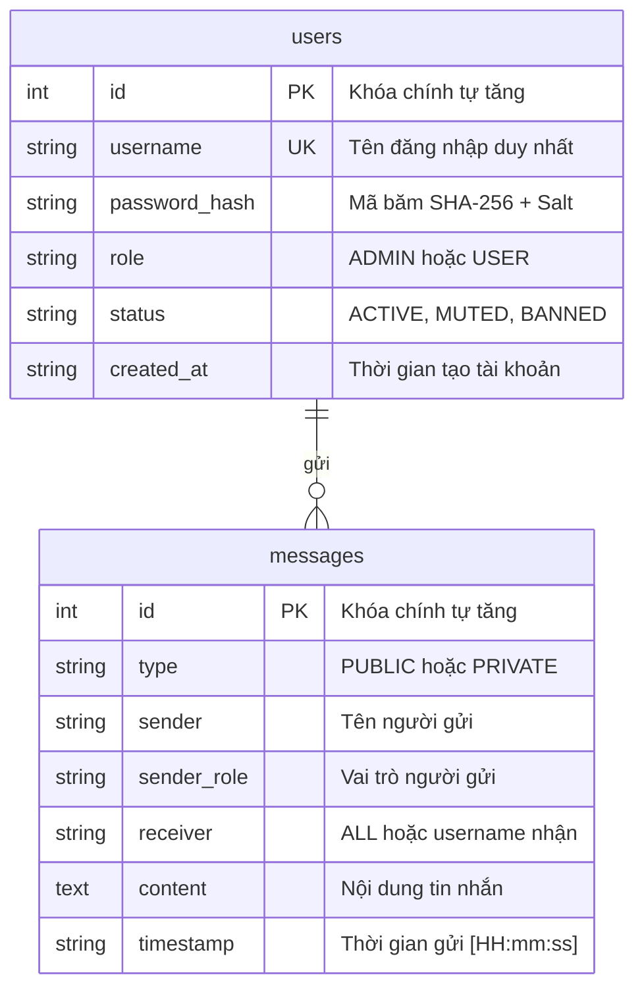
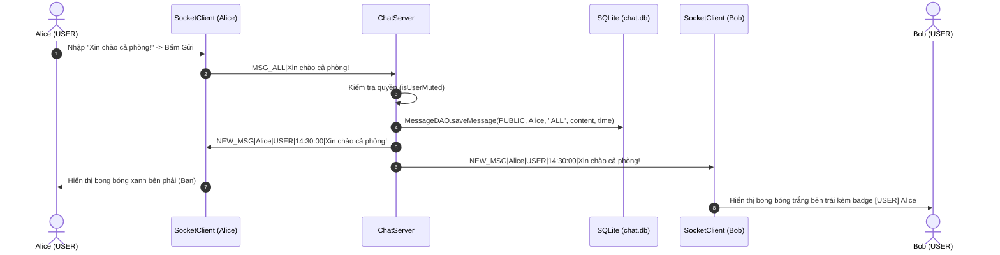
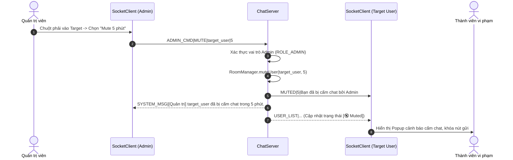

# BÁO CÁO ĐỒ ÁN MÔN HỌC: LẬP TRÌNH MẠNG
## ĐỀ TÀI: XÂY DỰNG CHAT ROOM NHIỀU NGƯỜI (MULTI-CLIENT CHAT SERVER)
**Ngôn ngữ & Công nghệ:** Java (Socket TCP Đa luồng), Java Swing (GUI), SQLite JDBC (Database).

---

## MỤC LỤC
1. [Giới thiệu đề tài & Mục tiêu](#1-giới-thiệu-đề-tài--mục-tiêu)
2. [Bảng phân chia vai trò & Nhiệm vụ 4 thành viên](#2-bảng-phân-chia-vai-trò--nhiệm-vụ-4-thành-viên)
3. [Kiến trúc hệ thống](#3-kiến-trúc-hệ-thống)
4. [Cơ chế Đa luồng & An toàn luồng (Concurrency & Thread-safety)](#4-cơ-chế-đa-luồng--an-toàn-luồng-concurrency--thread-safety)
5. [Cơ sở dữ liệu SQLite (chat.db) & Bảo mật](#5-cơ-sở-dữ-liệu-sqlite-chatdb--bảo-mật)
6. [Đặc tả Giao thức tầng ứng dụng (Application Protocol) & Sequence Diagrams](#6-đặc-tả-giao-thức-tầng-ứng-dụng-application-protocol--sequence-diagrams)
7. [Giao diện người dùng & Tính năng nổi bật](#7-giao-diện-người-dùng--tính-năng-nổi-bật)
8. [Bộ câu hỏi vấn đáp & Trả lời bảo vệ đồ án điểm cao](#8-bộ-câu-hỏi-vấn-đáp--trả-lời-bảo-vệ-đồ-án-điểm-cao)

---

## 1. Giới thiệu đề tài & Mục tiêu

### 1.1. Mục tiêu đồ án
- Xây dựng hoàn chỉnh một hệ thống ứng dụng phòng chat trực tuyến thời gian thực (Real-time Multi-client Chat Room) theo mô hình **Client - Server**.
- Vận dụng các kiến thức cốt lõi của môn học **Lập trình mạng**:
  1. Lập trình mạng Socket TCP tin cậy (`ServerSocket`, `Socket`).
  2. Xử lý đa nhiệm đồng thời (Multi-threading) và quản lý tài nguyên bằng Thread Pool (`ExecutorService`).
  3. Tự thiết kế và hiện thực hóa Giao thức trao đổi bản tin tầng ứng dụng (Application Layer Protocol).
  4. Quản lý dữ liệu quan hệ bền vững bằng CSDL nhúng **SQLite** với chế độ **WAL (Write-Ahead Logging)**.
  5. Bảo mật xác thực thông tin tài khoản bằng thuật toán mã hóa băm mật khẩu chuẩn **SHA-256**.
  6. Xây dựng giao diện đồ họa người dùng trực quan bằng **Java Swing**.

---

## 2. Bảng phân chia vai trò & Nhiệm vụ 4 thành viên

| Thành viên | Vai trò phụ trách | Các lớp & Module xây dựng | Khối lượng công việc đã hoàn thành |
| :--- | :--- | :--- | :--- |
| **Thành viên 1** | **Core Server, Concurrency & Tích hợp** | `common/Protocol.java`<br>`server/ChatServer.java`<br>`server/ClientHandler.java`<br>`server/RoomManager.java`<br>`server/ServerMain.java`<br>`server/ui/ServerGUI.java` | 1. Định nghĩa chuẩn giao thức truyền tin chung cho toàn nhóm.<br>2. Xây dựng lõi `ChatServer` quản lý `ServerSocket` và lắng nghe kết nối.<br>3. Điều phối luồng `ClientHandler` bằng `CachedThreadPool`.<br>4. Quản lý danh sách kết nối bằng `ConcurrentHashMap` an toàn luồng.<br>5. Xây dựng cơ chế định tuyến tin nhắn: Broadcast và Unicast (1-1).<br>6. Xây dựng giao diện Server Monitor trực quan cho giáo viên quan sát. |
| **Thành viên 2** | **Backend & Security (Auth, Phân quyền & DB)** | `common/User.java`<br>`common/MessagePacket.java`<br>`server/db/DatabaseConnection.java`<br>`server/db/UserDAO.java`<br>`server/db/MessageDAO.java` | 1. Thiết kế lược đồ CSDL SQLite (`users`, `messages`), cấu hình WAL.<br>2. Viết các lớp DAO kết nối JDBC thực hiện truy vấn CRUD.<br>3. Xây dựng chức năng Đăng ký, Đăng nhập, mã hóa SHA-256 có Salt.<br>4. Ngăn chặn đăng nhập trùng lặp (1 tài khoản đăng nhập ở 2 nơi).<br>5. Hiện thực hóa các tính năng kiểm duyệt: Kick, Mute có thời hạn, Khóa tài khoản (Ban).<br>6. Lưu trữ và nạp lại lịch sử trò chuyện khi người dùng đăng nhập. |
| **Thành viên 3** | **Client Core (Mạng Client & Luồng dữ liệu)** | `client/network/ChatEventListener.java`<br>`client/network/SocketClient.java`<br>`client/network/ServerListener.java` | 1. Xây dựng `SocketClient` kết nối TCP Socket tới Server qua IP và Port.<br>2. Tạo luồng `ServerListener` độc lập lắng nghe dữ liệu ngầm không làm treo UI.<br>3. Hiện thực cơ chế đóng gói (Serialize) và giải mã (Deserialize) bản tin.<br>4. Thiết kế mô hình callback `ChatEventListener` chuyển dữ liệu về giao diện.<br>5. Xử lý đóng kết nối an toàn, chống deadlock khi tắt socket. |
| **Thành viên 4** | **Frontend & GUI (Giao diện người dùng)** | `client/ui/LoginFrame.java`<br>`client/ui/ChatRoomFrame.java`<br>`client/ui/ChangePasswordDialog.java`<br>`client/ClientMain.java` | 1. Thiết kế giao diện Đăng nhập / Đăng ký và cấu hình IP/Port Server.<br>2. Thiết kế màn hình Chat Messenger hiện đại hiển thị bong bóng chat.<br>3. Danh sách người dùng Online với Badge phân quyền 👑 Admin và 👤 User.<br>4. Thanh công cụ và menu chuột phải Quản trị Admin (Kick, Mute, Ban).<br>5. Hỗ trợ phím Enter gửi tin, thông báo Popup khi bị Mute/Kick. |

---

## 3. Kiến trúc hệ thống

Hệ thống hoạt động theo kiến trúc hình sao tập trung (Star Topology), trong đó **ChatServer** đóng vai trò máy chủ điều phối trung tâm.

### 3.1. Sơ đồ khối kiến trúc hệ thống

```mermaid
flowchart TD
    subgraph Client1["Client 1 (Alice - USER)"]
        UI1["ChatRoomFrame (Swing)"]
        SC1["SocketClient"]
        SL1["ServerListener Thread"]
        UI1 <--> SC1
        SL1 -->|SwingUtilities.invokeLater| UI1
    end

    subgraph Client2["Client 2 (Admin - ADMIN)"]
        UI2["ChatRoomFrame (Swing)"]
        SC2["SocketClient"]
        SL2["ServerListener Thread"]
        UI2 <--> SC2
        SL2 -->|SwingUtilities.invokeLater| UI2
    end

    subgraph Server["ChatServer (Port: 5000)"]
        SS["ServerSocket (Port 5000)"]
        TP["ExecutorService (CachedThreadPool)"]
        CH1["ClientHandler 1"]
        CH2["ClientHandler 2"]
        RM["RoomManager (ConcurrentHashMap)"]
        SGUI["ServerGUI (Monitor Dashboard)"]

        SS -->|accept connection| TP
        TP --> CH1
        TP --> CH2
        CH1 <--> RM
        CH2 <--> RM
        RM <--> SGUI
    end

    subgraph Storage["Tầng Lưu Trữ (SQLite Database)"]
        DBC["DatabaseConnection (JDBC WAL)"]
        UDAO["UserDAO (users table)"]
        MDAO["MessageDAO (messages table)"]
        DB[(chat.db)]

        CH1 --> UDAO
        CH1 --> MDAO
        CH2 --> UDAO
        CH2 --> MDAO
        UDAO --> DBC
        MDAO --> DBC
        DBC --> DB
    end

    SC1 <-->|TCP Socket (Port 5000)| CH1
    SC2 <-->|TCP Socket (Port 5000)| CH2
```

---

## 4. Cơ chế Đa luồng & An toàn luồng (Concurrency & Thread-safety)

### 4.1. Phía Server
1. **Luồng chấp nhận kết nối (`Server-Accept-Thread`)**:
   - `serverSocket.accept()` chạy liên tục trên một luồng nền độc lập, không block tiến trình chính.
2. **Quản lý luồng bằng ThreadPool (`ExecutorService`)**:
   - Thay vì tạo `new Thread()` thủ công gây tốn RAM và chi phí context-switch lớn, Server sử dụng `Executors.newCachedThreadPool()`. Các luồng xử lý `ClientHandler` được tái sử dụng linh hoạt khi có Client mới kết nối.
3. **Cấu trúc dữ liệu an toàn luồng**:
   - Danh sách người dùng online sử dụng `ConcurrentHashMap<String, ClientHandler>`.
   - Danh sách thời hạn cấm chat sử dụng `ConcurrentHashMap<String, Long>`.
   - Phương thức gửi dữ liệu `sendPacket()` được bọc trong khối `synchronized` để chống hiện tượng ghi đè xen kẽ (interleaving) giữa các luồng.

### 4.2. Phía Client
- **Phân tách luồng mạng và luồng giao diện**:
  - Giao diện Swing chạy trên luồng **Event Dispatch Thread (EDT)**.
  - Luồng lắng nghe socket `ServerListener` chạy ngầm độc lập liên tục thực thi `in.readLine()`.
  - Mọi thao tác cập nhật giao diện (thêm bong bóng chat, cập nhật danh sách online, hiển thị popup) đều được đẩy về EDT thông qua hàm `SwingUtilities.invokeLater(...)`, ngăn ngừa triệt để hiện tượng đứng/treo ứng dụng (UI freeze) và vi phạm nguyên tắc Single-Thread Rule của Swing.

---

## 5. Cơ sở dữ liệu SQLite (chat.db) & Bảo mật

### 5.1. Sơ đồ thực thể CSDL (ERD)



### 5.2. Chế độ WAL (Write-Ahead Logging)
Trong môi trường phòng chat đa người dùng, nhiều luồng đọc và ghi diễn ra liên tục. Hệ thống kích hoạt cấu hình:
```sql
PRAGMA journal_mode=WAL;
PRAGMA busy_timeout=5000;
```
Chế độ WAL cho phép các luồng Đọc (`SELECT`) và luồng Ghi (`INSERT`) chạy song song đồng thời mà không khóa chặn lẫn nhau.

### 5.3. Bảo mật mật khẩu (SHA-256 with Salt)
Mật khẩu người dùng không bao giờ được lưu trữ dưới dạng văn bản thô (plain-text). Khi đăng ký, mật khẩu được ghép với chuỗi Salt bí mật hệ thống và băm bằng thuật toán **SHA-256** tạo ra chuỗi băm hex 64 ký tự an toàn trước các cuộc tấn công Rainbow Table.

---

## 6. Đặc tả Giao thức tầng ứng dụng (Application Protocol) & Sequence Diagrams

### 6.1. Luồng Đăng nhập (Authentication Flow)

```mermaid
sequenceDiagram
    autonumber
    actor User as Client (Người dùng)
    participant UI as LoginFrame
    participant SC as SocketClient
    participant S as ServerSocket / Handler
    participant DB as SQLite (chat.db)

    User->>UI: Nhập username, password -> Nhấn Đăng Nhập
    UI->>SC: connect("127.0.0.1", 5000)
    SC->>S: Bắt tay TCP 3 bước (SYN, SYN-ACK, ACK)
    SC->>S: Gửi gói tin LOGIN|username|password
    S->>DB: UserDAO.login(username, SHA256(password))
    DB-->>S: Trả về đối tượng User (role, status)
    alt Đăng nhập thành công
        S->>SC: LOGIN_RES|SUCCESS|ADMIN|username
        S->>DB: MessageDAO.getRecentMessages(30)
        DB-->>S: Danh sách 30 tin nhắn gần nhất
        S->>SC: HISTORY|30|msg1;;msg2;;...
        S->>S: RoomManager.addClient(username)
        S-->>SC: USER_LIST|admin:ADMIN:ACTIVE,user1:USER:ACTIVE
        SC->>UI: onLoginResult(true) & onHistoryReceived(...)
        UI->>User: Mở ChatRoomFrame chính
    else Sai thông tin hoặc bị Ban
        S->>SC: LOGIN_RES|FAILED|Lý do thất bại
        SC->>UI: onLoginResult(false, lý_do)
        UI->>User: Hiển thị hộp thoại báo lỗi
    end
```

### 6.2. Luồng Phát tin nhắn phòng chung (Public Chat Broadcast)



### 6.3. Luồng Quản trị kiểm duyệt Admin (Kick & Mute)



---

## 7. Giao diện người dùng & Tính năng nổi bật

### 7.1. Giao diện Server Monitor (`ServerGUI`)
- Hiển thị trực tiếp thông số Port, nút Bật/Tắt Server.
- Bộ đếm thời gian thực số Client Online và tổng số tin nhắn lưu thông.
- Bảng danh sách Client chi tiết: Username, Role, IP Address, Trạng thái hoạt động.
- Nút Kick thành viên trực tiếp từ Server Host.
- Khung nhật ký hoạt động (Server Logs) hiển thị timestamp chi tiết mọi sự kiện kết nối/ngắt kết nối/tin nhắn.
- Hộp thoại phát thông báo khẩn cấp từ Server Host tới toàn phòng chat.

### 7.2. Giao diện Client Messenger (`ChatRoomFrame`)
- Phân biệt rõ ràng vai trò người dùng bằng huy hiệu màu sắc: 👑 **[ADMIN]** màu vàng hoàng gia, 👤 **[USER]** màu xanh lam.
- Khung chat HTML cao cấp:
  + Tin nhắn của chính mình: Căn lề phải, bong bóng màu xanh biển sang trọng.
  + Tin nhắn của thành viên khác: Căn lề trái, hiển thị avatar tên và vai trò.
  + Tin nhắn riêng tư 1-1: Nổi bật với viền tím nhạt kèm tiền tố bí mật `🔒 [TIN NHẬN MẬT]`.
  + Tin nhắn hệ thống: Căn giữa, chữ nghiêng xám tinh tế.
- Tự động cuộn xuống dòng mới nhất khi có tin nhắn mới.
- Hỗ trợ phím tắt **Enter** để gửi tin nhanh.
- Danh sách Online có thanh tìm kiếm lọc người dùng thời gian thực.
- Menu chuột phải tích hợp đầy đủ công cụ quản trị Admin (Kick, Mute 5/15 phút/vô thời hạn, Unmute, Ban vĩnh viễn).

---

## 8. Bộ câu hỏi vấn đáp & Trả lời bảo vệ đồ án điểm cao

Dưới đây là bộ câu hỏi trọng tâm thường được hội đồng giảng viên hỏi khi bảo vệ môn Lập trình mạng:

### ❓ Câu 1 (Dành cho TV1): Tại sao lại chọn giao thức TCP thay vì UDP cho hệ thống Chat?
> **Trả lời:** Ứng dụng chat yêu cầu tính toàn vẹn và độ tin cậy tuyệt đối: tin nhắn không được phép bị mất gói, không được trùng lặp và bắt buộc phải đúng thứ tự hiển thị. Giao thức TCP cung cấp cơ chế bắt tay 3 bước (3-way handshake), kiểm soát luồng (flow control) và truyền lại gói tin lỗi (ACK/retransmission), trong khi UDP không đảm bảo thứ tự và có thể làm rơi tin nhắn khi mạng chập chờn.

### ❓ Câu 2 (Dành cho TV1): Tại sao dùng `Executors.newCachedThreadPool()` thay vì tạo `new Thread()` thủ công?
> **Trả lời:** Việc tạo luồng thủ công (`new Thread()`) tiêu tốn đáng kể bộ nhớ hệ thống (stack memory) và chi phí chuyển đổi ngữ cảnh (context-switch) của CPU. Khi có nhiều client kết nối và ngắt liên tục, hệ thống dễ cạn kiệt tài nguyên (`OutOfMemoryError`). `CachedThreadPool` giúp tái sử dụng các luồng đã có sẵn trong hồ bơi và tự động giải phóng các luồng nhàn rỗi sau 60 giây, giúp tối ưu hiệu năng và khả năng mở rộng của Server.

### ❓ Câu 3 (Dành cho TV2): Vì sao lại chọn SQLite và bật chế độ WAL cho đồ án mạng?
> **Trả lời:** SQLite là CSDL nhúng lưu trữ toàn bộ dữ liệu thành 1 file duy nhất (`chat.db`), không cần cài đặt dịch vụ database riêng biệt, rất tiện lợi khi nộp bài và chạy thử nghiệm. Tuy nhiên, mặc định SQLite sẽ khóa toàn bộ file khi có ghi dữ liệu. Bằng cách kích hoạt `PRAGMA journal_mode=WAL;` (Write-Ahead Logging), các luồng Đọc và Ghi có thể chạy song song độc lập, giải quyết triệt để tình trạng nghẽn kết nối khi nhiều người chat cùng lúc.

### ❓ Câu 4 (Dành cho TV2): Tại sao phải băm mật khẩu bằng SHA-256 kèm Salt thay vì lưu mật khẩu trực tiếp?
> **Trả lời:** Lưu mật khẩu dạng thô (plain-text) sẽ gây rò rỉ thông tin nghiêm trọng nếu file CSDL bị đánh cắp. Việc băm bằng thuật toán SHA-256 biến mật khẩu thành chuỗi 1 chiều không thể dịch ngược. Thêm chuỗi "Salt" bí mật giúp vô hiệu hóa các bảng băm sẵn (Rainbow Tables), chống lại việc dò quét mật khẩu phổ biến của kẻ tấn công.

### ❓ Câu 5 (Dành cho TV3): Làm thế nào để luồng đọc dữ liệu từ Server không làm treo giao diện người dùng (UI Freeze)?
> **Trả lời:** Phía Client phân tách thành 2 luồng riêng biệt: Luồng giao diện Swing (Event Dispatch Thread - EDT) chỉ lo việc hiển thị và tương tác chuột/phím. Một luồng nền độc lập (`ServerListener Thread`) được tạo ra chuyên đảm nhiệm việc đọc socket (`in.readLine()`). Khi có dữ liệu trả về, luồng nền sẽ chuyển giao dữ liệu sang EDT bằng hàm `SwingUtilities.invokeLater(...)` để đảm bảo tuân thủ nguyên tắc đơn luồng an toàn của Swing.

### ❓ Câu 6 (Dành cho TV3): Khi tắt ứng dụng Client, làm sao để tránh tình trạng treo Socket hoặc rò rỉ tài nguyên (Resource Leak)?
> **Trả lời:** Lớp `SocketClient` có phương thức `disconnect()` thực hiện đóng socket trước (`socket.close()`). Việc đóng socket sẽ giải phóng ngay lập tức lệnh `readLine()` đang bị chặn (blocking) ở luồng đọc ngầm, từ đó cho phép các luồng đóng an toàn theo thứ tự và đóng các stream `in`, `out` mà không gây ra hiện tượng deadlock giữa các luồng.

### ❓ Câu 7 (Dành cho TV4): Làm thế nào để phân biệt tin nhắn của chính mình, của người khác và tin nhắn mật trên giao diện?
> **Trả lời:** Lớp `ChatRoomFrame` sử dụng `JTextPane` kết hợp `HTMLEditorKit`. Khi nhận gói tin:
> - Nếu `sender` trùng với `currentUsername`: render lớp CSS `.msg-mine` căn lề phải với nền xanh.
> - Nếu là tin nhắn phòng chung từ người khác: render lớp `.msg-container` căn lề trái, hiển thị avatar và huy hiệu vai trò 👑 Admin hoặc 👤 User.
> - Nếu là tin nhắn riêng 1-1: render lớp `.bubble-private` màu tím với tiêu đề `[TIN NHẬN MẬT]`.
> - Nếu là tin hệ thống: căn giữa chữ nghiêng màu xám.

### ❓ Câu 8 (Dành cho TV4): Cơ chế kiểm soát quyền hạn (RBAC) trên giao diện được hiện thực ra sao?
> **Trả lời:** Khi đăng nhập thành công, Server gửi về vai trò (`ROLE_ADMIN` hoặc `ROLE_USER`). Client lưu lại vai trò này trong biến `currentRole`:
> - Nếu là `USER`: Ẩn thanh công cụ Quản trị, các menu chuột phải chỉ có chức năng "Nhắn tin riêng".
> - Nếu là `ADMIN`: Hiển thị thanh công cụ màu vàng có nút "Thông báo toàn phòng", "Xóa lịch sử"; menu chuột phải bổ sung thêm các tùy chọn Kick, Mute có thời hạn, Mở cấm chat và Khóa tài khoản vĩnh viễn (Ban).

---
*(Báo cáo hoàn thành - Sẵn sàng cho toàn bộ 4 thành viên nộp bài và bảo vệ đạt kết quả xuất sắc!)*

